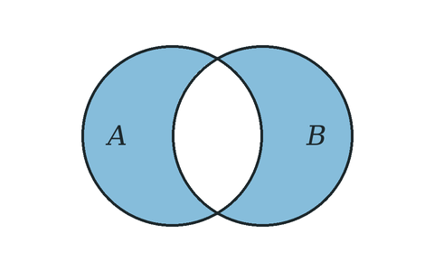

# Symmetric difference

$A \mathbin{\triangle} B = (A \setminus B) \cup (B \setminus A)$

The elements in exactly one of the two sets.

## See also

- [Set difference](../../operations_on_sets/set_difference/index.md): built from

---

Up: [Operations on sets](../index.md)
