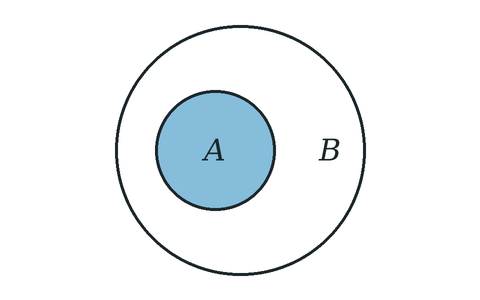

# Subsets

$A$ is a **subset** of $B$, written $A \subseteq B$ or $A \subset B$, when every element of $A$ is also an element of $B$:

$$(\forall x)\ x \in A \Rightarrow x \in B$$

## Contents

- [Double inclusion](double_inclusion/index.md)

---

Up: [Sets](../index.md)
