# Your first mind map

In this tutorial you'll plan a holiday in the Netherlands with the Mind Map Editor. By the end you'll have this map, saved as a file on your own computer:

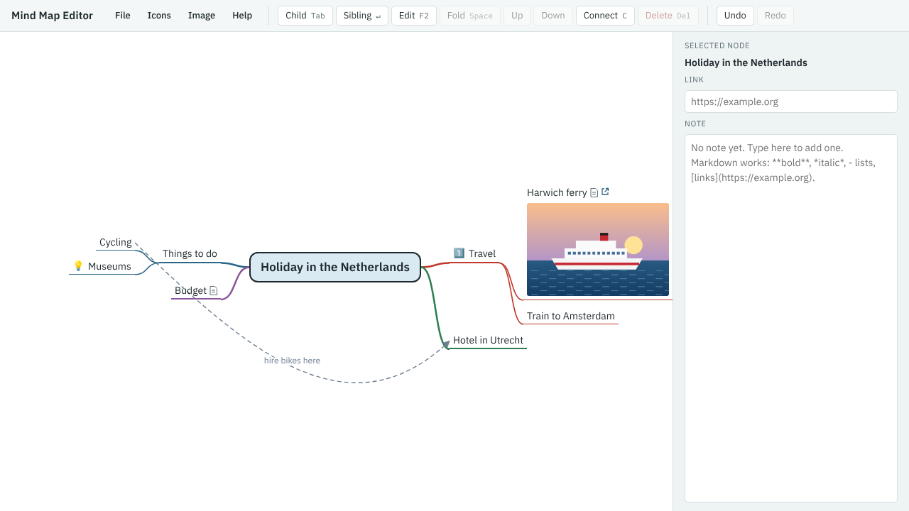

On the way you'll learn how to:

- add, rename and delete branches, and undo a mistake;
- write notes, with formatting and maths;
- attach a web link and a picture to a branch;
- mark branches with icons and connect them with arrows;
- tidy the map, and save it and open it again.

It takes about 20 minutes. All you need is a web browser.

## On a touchscreen

The tutorial gives keyboard keys, because they're quickest on a computer. On a tablet or phone, use the toolbar buttons at the top of the editor instead. Each key has a button:

| Key | Button | What it does |
|---|---|---|
| Tab | **Child** | Add a branch below the selected one |
| Enter | **Sibling** | Add a branch next to the selected one |
| F2 | **Edit**, or double-tap the branch | Change the selected branch's title |
| Delete | **Delete** | Delete the selected branch |
| Space | **Fold** | Fold or unfold the selected branch |
| Ctrl+↑ and Ctrl+↓ | **Up** and **Down** | Move the selected branch among its neighbours |
| C | **Connect** | Draw an arrow to another branch |
| Ctrl+Z and Ctrl+Y | **Undo** and **Redo** | Undo or redo a change |

Where the tutorial says to press an arrow key to move around, tap the branch you want instead. Where it says to press Esc to leave a note or close a menu, tap the map.

## 1. Start a new map

1. Open the [Mind Map Editor](../../mindmap-editor.html). The first time, it shows a sample map.
2. Choose **File** → **New map**. The map now has just a central topic, called "New mind map".
3. Double-click the central topic (double-tap on a touchscreen), type `Holiday in the Netherlands`, and press Enter.

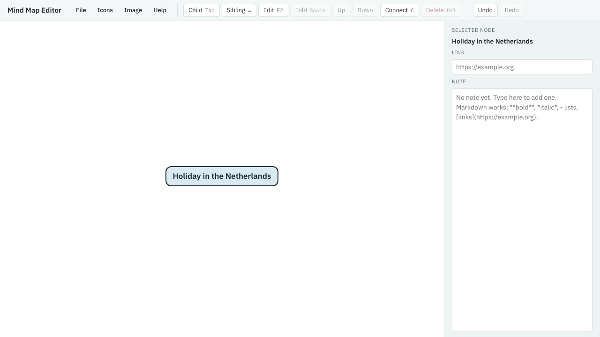

The blue background shows that the central topic is selected. Most commands act on the selected branch, so you'll select a branch before doing something to it.

## 2. Add your main branches

1. With the central topic selected, press Tab (**Child**). A new branch appears, ready for its title. Type `Travel` and press Enter.
2. Press Enter (**Sibling**) to add a branch next to Travel. Type `Where to stay` and press Enter.
3. Click the central topic to select it, press Tab, type `Things to do` and press Enter.

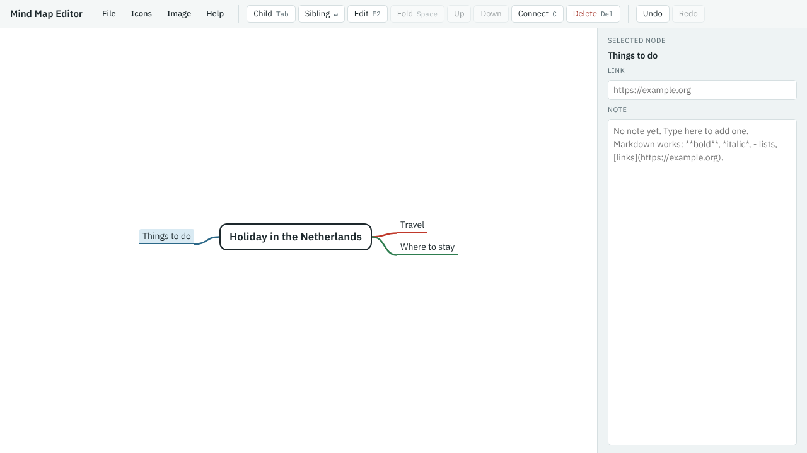

The branches added from the central topic are shared between its left and right sides, so the map stays balanced. Where to stay went on the right because it was added next to Travel.

## 3. Add detail

1. Select **Travel**, press Tab, and add `Harwich ferry`. Press Enter and add `Train to Amsterdam`.
2. Select **Things to do** and add two branches below it: `Museums` and `Cycling`.
3. You've found a hotel, so rename **Where to stay**: select it, press F2 (**Edit**), type `Hotel in Utrecht` and press Enter.

Now try a mistake:

4. Select **Museums** and press Delete. The branch disappears.
5. Press Ctrl+Z (**Undo**). It comes back.

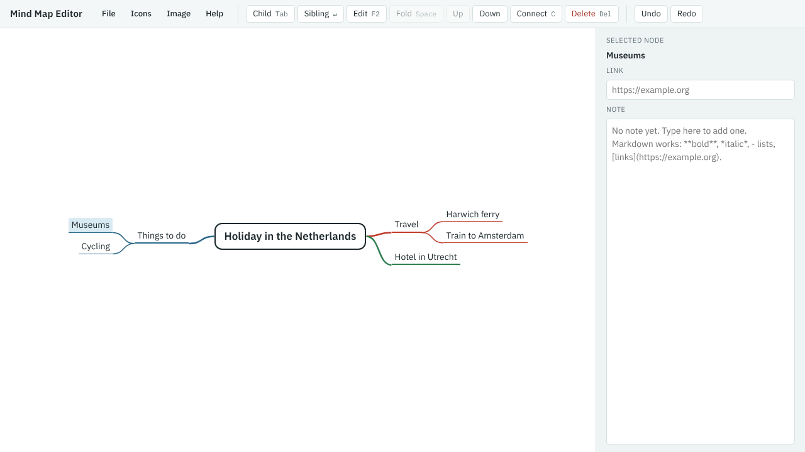

You can also move around with the arrow keys: ← and → go towards or away from the centre, and ↑ and ↓ go between neighbouring branches.

## 4. Write a note

Each branch can have a note, shown in the panel on the right (below the map on a phone).

1. Select **Harwich ferry**.
2. Click in the **Note** box and type:

   ```
   Book the **night ferry** from Harwich.

   - bikes go free
   - cabin for two
   ```

3. Press Esc, or click the map.

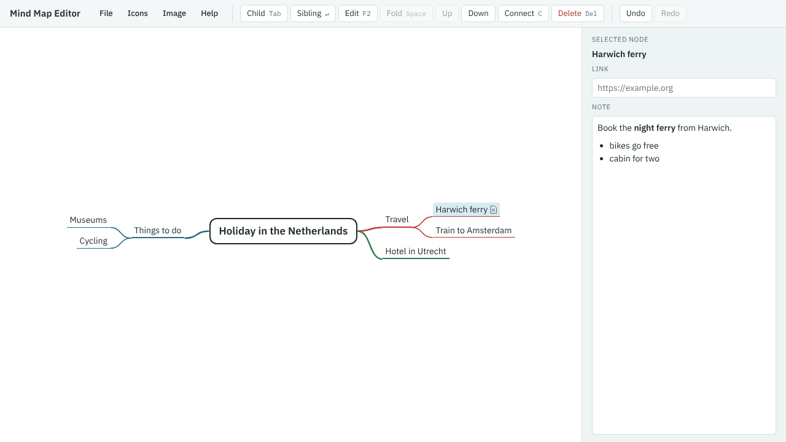

Notes are written in Markdown: `**…**` makes bold text and lines starting with `- ` make a list. When you leave the note it is shown formatted. Click it to edit it again. Harwich ferry now shows a small page icon, so you can see which branches have notes.

## 5. Add a web link

1. With **Harwich ferry** still selected, click the **Link** box (or press Ctrl+K).
2. Type `www.stenaline.co.uk` and press Enter.

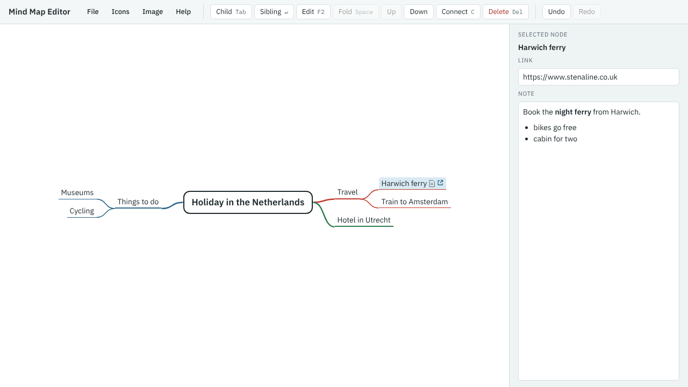

The editor adds `https://` for you. Harwich ferry now has a link icon. Click it to open the site in a new tab.

## 6. Add a picture

You'll need a PNG or JPEG picture. Use a photo of your own, or save [this drawing of a ferry](images/harwich_ferry.png).

1. With **Harwich ferry** selected, choose **Image** → **Attach image…**.
2. Choose your picture. On a phone or tablet you can also choose a photo or take one with the camera.

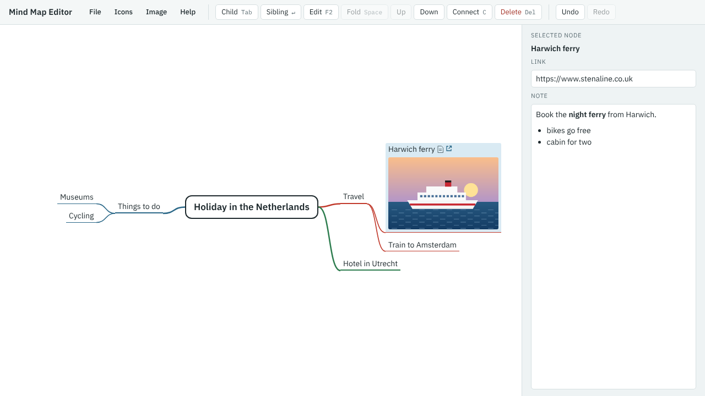

The picture is shown under the branch's title. You can also drag a picture file onto a branch, or paste one to put it on the selected branch.

## 7. Mark branches with icons

1. Select **Travel**, and choose **Icons** → **1** (Priority 1, the first icon). Press Esc to close the menu.
2. Select **Museums**, and choose **Icons** → **💡** (Idea). Press Esc.

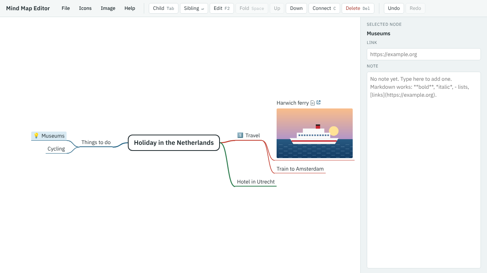

The Icons menu has about 60 icons, in groups. To take an icon off, choose it again; **Remove all icons** clears them all.

## 8. Connect two branches

You plan to hire bikes at the hotel, so connect Cycling to Hotel in Utrecht.

1. Select **Cycling**.
2. Press C (**Connect**). A message asks you to choose the other branch.
3. Click **Hotel in Utrecht**.
4. The **Label** box is ready for you. Type `hire bikes here` and press Enter.
5. Press Esc to go back to the map.

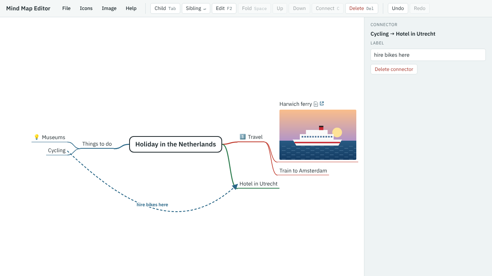

A connector is a dashed arrow from one branch to any other. Click it later to change its label or delete it.

## 9. Do some sums in a note

Notes can include mathematics, written in LaTeX.

1. Select the central topic, press Tab, and add a branch called `Budget`.
2. Click in its **Note** box and type:

   ```
   Total for $n$ nights:

   $$C = n \times (h + f)$$
   ```

3. Press Esc.

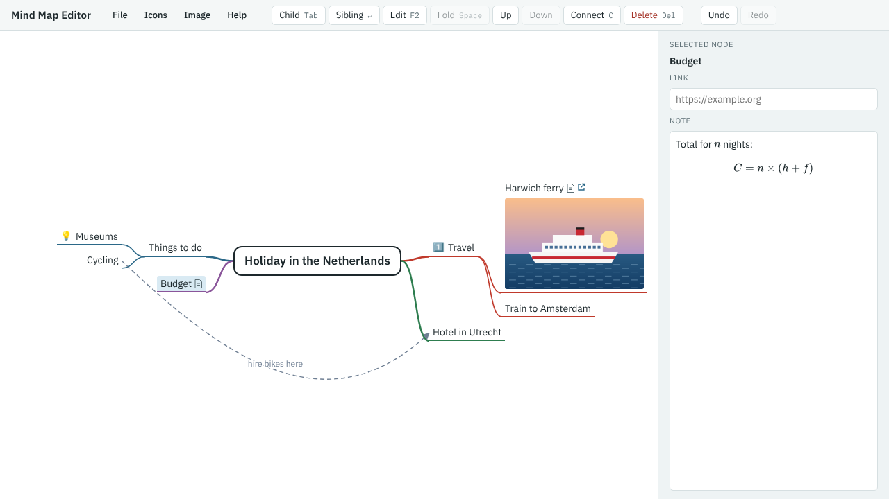

`$…$` marks a formula inside a line, and `$$…$$` one on a line of its own. **Help** has a short guide to writing formulas. If a formula has a mistake, it is shown in red.

## 10. Tidy up

1. Select **Cycling** and press Ctrl+↑ (**Up**). Cycling moves above Museums.
2. Select **Things to do** and press Space (**Fold**). Its branches are hidden, and a circle shows how many there are.

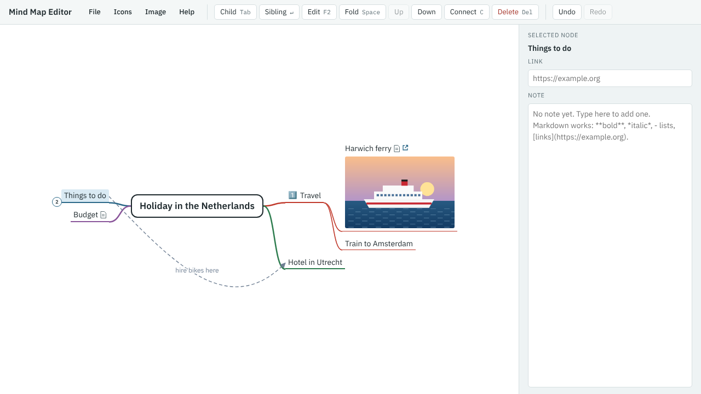

3. Press Space again to unfold it.

Folding helps when a map gets big: you can hide the parts you aren't working on.

## 11. Save your map, and open it again

1. Choose **File** → **Save** (or press Ctrl+S). Your browser downloads a file called `holiday_in_the_netherlands.zip`.
2. Choose **File** → **New map**. Your map is replaced by an empty one.
3. Choose **File** → **Open…** (or press Ctrl+O), and choose the file you saved.

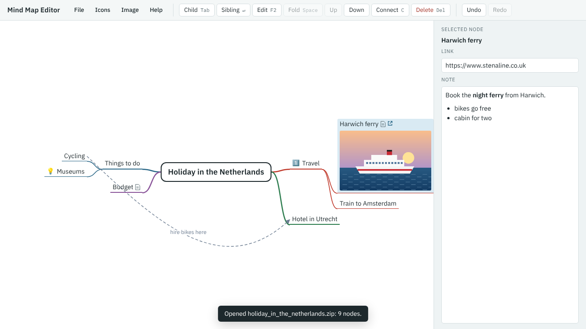

Everything comes back: the branches, notes, link, picture, icons and connector.

The editor also remembers your map in this browser, so it's still there if you close the page and come back. That copy isn't shared with other browsers or devices, and clearing your browsing data deletes it. The saved file is your real copy: keep it, back it up, or send it to someone else.

## What next

You've used all the main features of the Mind Map Editor. To go further:

- Press `?` in the editor, or choose **Help**, for every key and menu.
- [The file format](../reference/file-format.md) explains what's inside the saved file, if you want to write maps with a program or an AI assistant.
- [Back to the Mind Map Editor page](../index.md)
