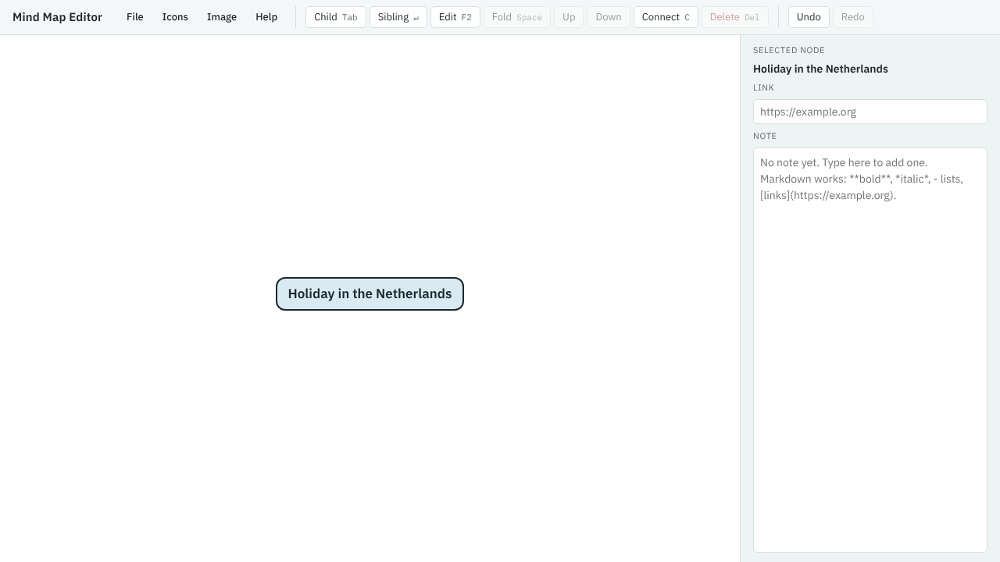

1. Open the [Mind Map Editor](../../../mindmap-editor.html). The first time, it shows a sample map.
2. Choose **File** → **New map**. The map now has just a central topic, called "New mind map".
3. Double-click the central topic (double-tap on a touchscreen), type `Holiday in the Netherlands`, and press Enter.

The blue background shows that the central topic is selected. Most commands act on the selected branch, so you'll select a branch before doing something to it.
