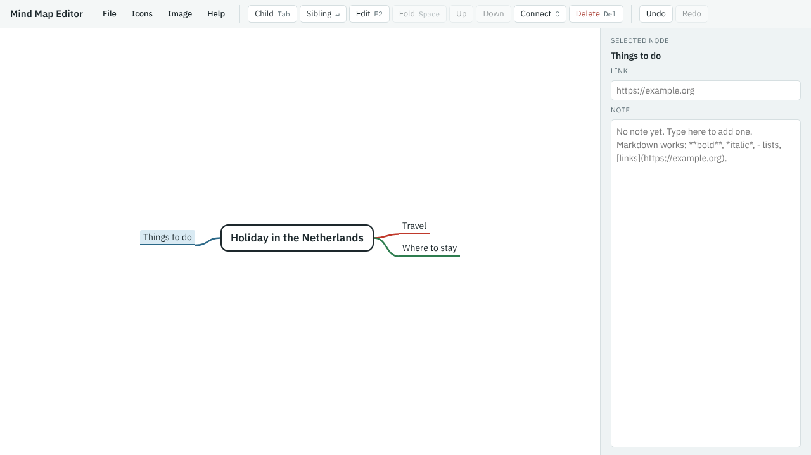

[Your first mind map](index.md) · Step 2 of 11

# 2. Add your main branches

1. With the central topic selected, press Tab (**Child**). A new branch appears, ready for its title. Type `Travel` and press Enter.
2. Press Enter (**Sibling**) to add a branch next to Travel. Type `Where to stay` and press Enter.
3. Click the central topic to select it, press Tab, type `Things to do` and press Enter.

The branches added from the central topic are shared between its left and right sides, so the map stays balanced. Where to stay went on the right because it was added next to Travel.

---

[← Previous: Start a new map](01-start-a-new-map.md) · [Contents](index.md) · [Next: Add detail →](03-add-detail.md)
