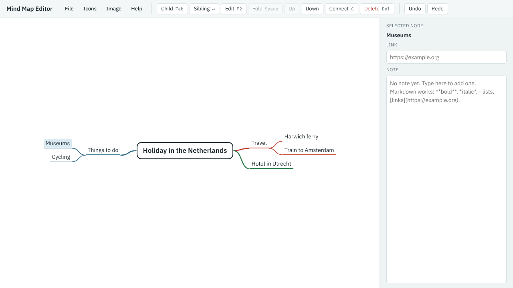

[Your first mind map](index.md) · Step 3 of 11

# 3. Add detail

1. Select **Travel**, press Tab, and add `Harwich ferry`. Press Enter and add `Train to Amsterdam`.
2. Select **Things to do** and add two branches below it: `Museums` and `Cycling`.
3. You've found a hotel, so rename **Where to stay**: select it, press F2 (**Edit**), type `Hotel in Utrecht` and press Enter.

Now try a mistake:

4. Select **Museums** and press Delete. The branch disappears.
5. Press Ctrl+Z (**Undo**). It comes back.

You can also move around with the arrow keys: ← and → go towards or away from the centre, and ↑ and ↓ go between neighbouring branches.

---

[← Previous: Add your main branches](02-add-your-main-branches.md) · [Contents](index.md) · [Next: Write a note →](04-write-a-note.md)
