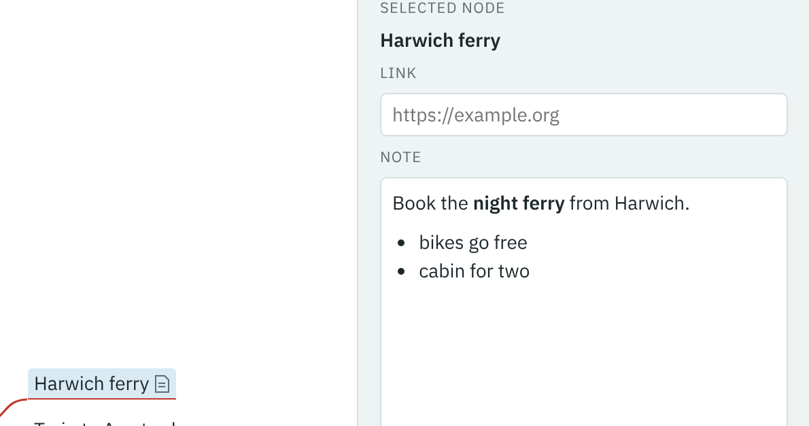

Each branch can have a note, shown in the panel on the right (below the map on a phone).

1. Select **Harwich ferry**.
2. Click in the **Note** box and type:

   ```
   Book the **night ferry** from Harwich.

   - bikes go free
   - cabin for two
   ```

3. Press Esc, or click the map.

[](../images/note.png)

Notes are written in Markdown: `**…**` makes bold text and lines starting with `- ` make a list. When you leave the note it is shown formatted. Click it to edit it again. Harwich ferry now shows a small page icon, so you can see which branches have notes.
