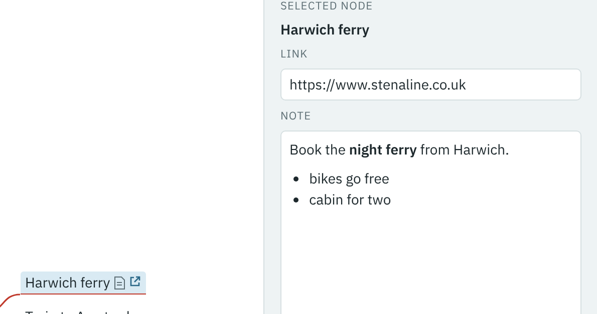

1. With **Harwich ferry** still selected, click the **Link** box (or press Ctrl+K).
2. Type `www.stenaline.co.uk` and press Enter.

The editor adds `https://` for you. Harwich ferry now has a link icon. Click it to open the site in a new tab.
