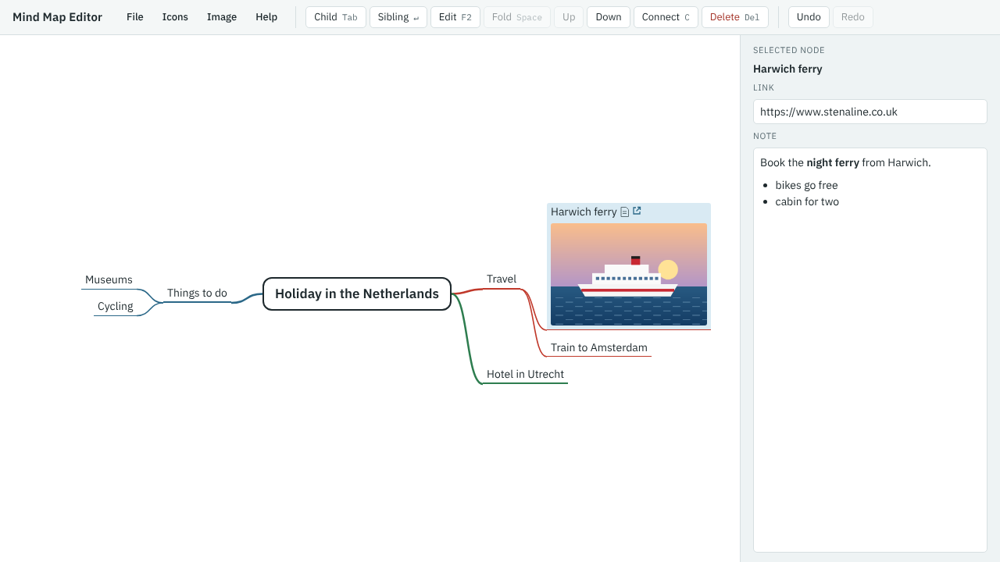

[Your first mind map](index.md) · Step 6 of 11

# 6. Add a picture

You'll need a PNG or JPEG picture. Use a photo of your own, or save [this drawing of a ferry](../images/harwich_ferry.png).

1. With **Harwich ferry** selected, choose **Image** → **Attach image…**.
2. Choose your picture. On a phone or tablet you can also choose a photo or take one with the camera.

The picture is shown under the branch's title. You can also drag a picture file onto a branch, or paste one to put it on the selected branch.

---

[← Previous: Add a web link](05-add-a-web-link.md) · [Contents](index.md) · [Next: Mark branches with icons →](07-mark-branches-with-icons.md)
