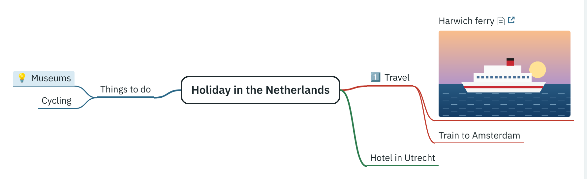

[Your first mind map](index.md) · Step 7 of 11

# 7. Mark branches with icons

1. Select **Travel**, and choose **Icons** → **1** (Priority 1, the first icon). Press Esc to close the menu.
2. Select **Museums**, and choose **Icons** → **💡** (Idea). Press Esc.

The Icons menu has about 60 icons, in groups. To take an icon off, choose it again; **Remove all icons** clears them all.

---

[← Previous: Add a picture](06-add-a-picture.md) · [Contents](index.md) · [Next: Connect two branches →](08-connect-two-branches.md)
