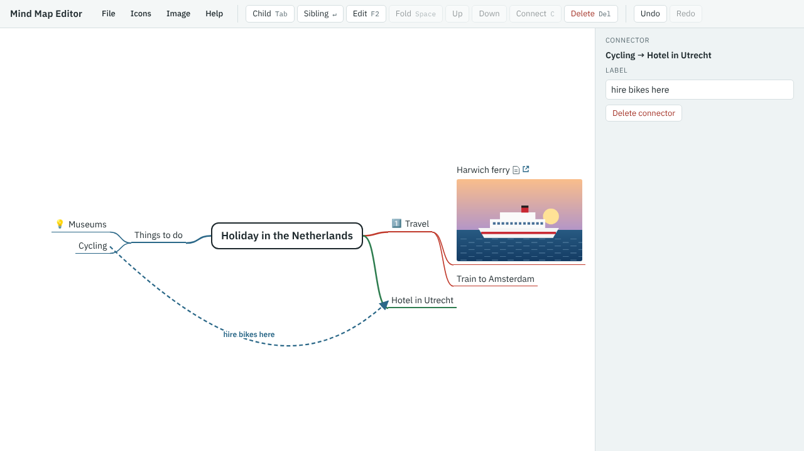

You plan to hire bikes at the hotel, so connect Cycling to Hotel in Utrecht.

1. Select **Cycling**.
2. Press C (**Connect**). A message asks you to choose the other branch.
3. Click **Hotel in Utrecht**.
4. The **Label** box is ready for you. Type `hire bikes here` and press Enter.
5. Press Esc to go back to the map.

A connector is a dashed arrow from one branch to any other. Click it later to change its label or delete it.
