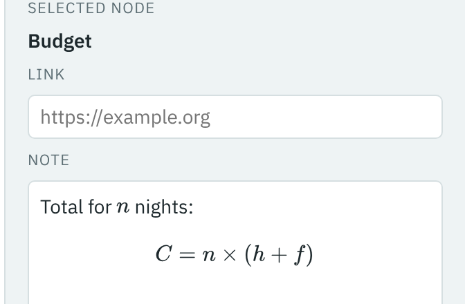

[Your first mind map](index.md) · Step 9 of 11

# 9. Do some sums in a note

Notes can include mathematics, written in LaTeX.

1. Select the central topic, press Tab, and add a branch called `Budget`.
2. Click in its **Note** box and type:

   ```
   Total for $n$ nights:

   $$C = n \times (h + f)$$
   ```

3. Press Esc.



`$…$` marks a formula inside a line, and `$$…$$` one on a line of its own. **Help** has a short guide to writing formulas. If a formula has a mistake, it is shown in red.

---

[← Previous: Connect two branches](08-connect-two-branches.md) · [Contents](index.md) · [Next: Tidy up →](10-tidy-up.md)
