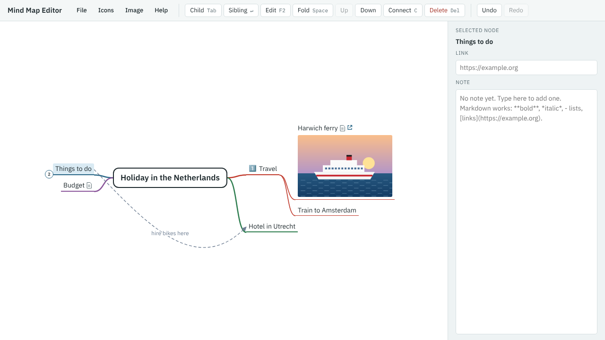

1. Select **Cycling** and press Ctrl+↑ (**Up**). Cycling moves above Museums.
2. Select **Things to do** and press Space (**Fold**). Its branches are hidden, and a circle shows how many there are.

3. Press Space again to unfold it.

Folding helps when a map gets big: you can hide the parts you aren't working on.
