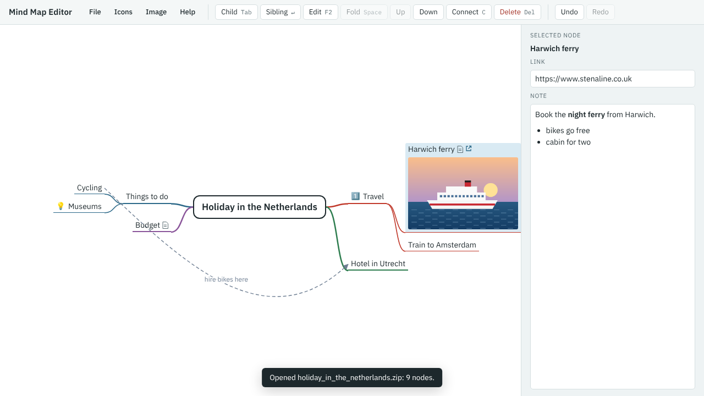

[Your first mind map](index.md) · Step 11 of 11

# 11. Save your map, and open it again

1. Choose **File** → **Save** (or press Ctrl+S). Your browser downloads a file called `holiday_in_the_netherlands.zip`.
2. Choose **File** → **New map**. Your map is replaced by an empty one.
3. Choose **File** → **Open…** (or press Ctrl+O), and choose the file you saved.

Everything comes back: the branches, notes, link, picture, icons and connector.

The editor also remembers your map in this browser, so it's still there if you close the page and come back. That copy isn't shared with other browsers or devices, and clearing your browsing data deletes it. The saved file is your real copy: keep it, back it up, or send it to someone else.

## What next

You've used all the main features of the Mind Map Editor. To go further:

- Press `?` in the editor, or choose **Help**, for every key and menu.
- [The file format](../../reference/file-format.md) explains what's inside the saved file, if you want to write maps with a program or an AI assistant.
- [Back to the Mind Map Editor page](../../index.md)

---

[← Previous: Tidy up](10-tidy-up.md) · [Contents](index.md)
