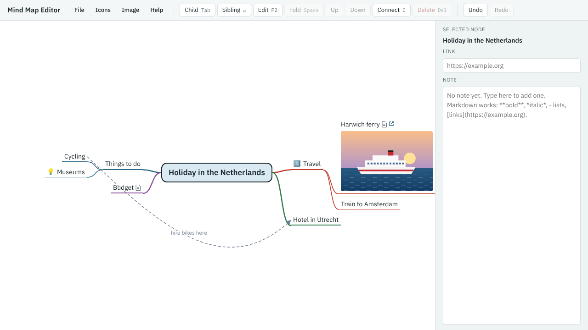

# Your first mind map

In this tutorial you'll plan a holiday in the Netherlands with the Mind Map Editor. By the end you'll have this map, saved as a file on your own computer:

On the way you'll learn how to:

- add, rename and delete branches, and undo a mistake;
- write notes, with formatting and maths;
- attach a web link and a picture to a branch;
- mark branches with icons and connect them with arrows;
- tidy the map, and save it and open it again.

It takes about 20 minutes. All you need is a web browser.

## On a touchscreen

The tutorial gives keyboard keys, because they're quickest on a computer. On a tablet or phone, use the toolbar buttons at the top of the editor instead. Each key has a button:

| Key | Button | What it does |
|---|---|---|
| Tab | **Child** | Add a branch below the selected one |
| Enter | **Sibling** | Add a branch next to the selected one |
| F2 | **Edit**, or double-tap the branch | Change the selected branch's title |
| Delete | **Delete** | Delete the selected branch |
| Space | **Fold** | Fold or unfold the selected branch |
| Ctrl+↑ and Ctrl+↓ | **Up** and **Down** | Move the selected branch among its neighbours |
| C | **Connect** | Draw an arrow to another branch |
| Ctrl+Z and Ctrl+Y | **Undo** and **Redo** | Undo or redo a change |

Where the tutorial says to press an arrow key to move around, tap the branch you want instead. Where it says to press Esc to leave a note or close a menu, tap the map.

## Steps

1. [Start a new map](01-start-a-new-map.md)
2. [Add your main branches](02-add-your-main-branches.md)
3. [Add detail](03-add-detail.md)
4. [Write a note](04-write-a-note.md)
5. [Add a web link](05-add-a-web-link.md)
6. [Add a picture](06-add-a-picture.md)
7. [Mark branches with icons](07-mark-branches-with-icons.md)
8. [Connect two branches](08-connect-two-branches.md)
9. [Do some sums in a note](09-sums-in-a-note.md)
10. [Tidy up](10-tidy-up.md)
11. [Save your map, and open it again](11-save-and-open.md)

**[Start with step 1: Start a new map →](01-start-a-new-map.md)**

[Back to the Mind Map Editor page](../../index.md)
